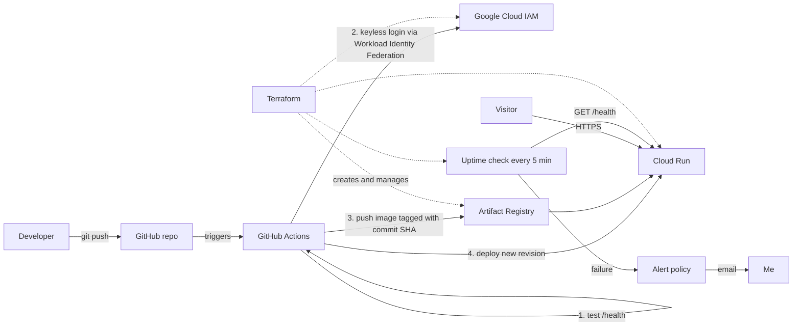

# Notice Board: automated deployment on Google Cloud

A small web app that is built, tested and deployed automatically on every push, running on Google Cloud with all infrastructure written as code.

## Architecture

## What is in this repo

| Path | Purpose |
| --- | --- |
| `app/main.py` | The web app (Python standard library only). Serves a page and `/health`. |
| `Dockerfile` | Recipe that packages the app into a container image. |
| `terraform/` | All infrastructure as code: registry, Cloud Run, service accounts, Workload Identity Federation, monitoring. |
| `.github/workflows/deploy.yml` | The CI/CD pipeline. |

## How the pipeline works

1. **check job**: starts the app and fails the run if `/health` does not return `ok`. A broken change never reaches production.
2. **deploy job** (runs only if `check` passed):
   - logs in to Google Cloud with **Workload Identity Federation**, so no service account key is stored anywhere;
   - builds the image and tags it with the short commit SHA, so every deployment is traceable and can be rolled back;
   - pushes it to Artifact Registry and updates Cloud Run;
   - health-checks the live site.

## Security decisions

- **No stored credentials.** GitHub proves its identity with a short-lived token. Only this repository can impersonate the deployer account.
- **Least privilege.** The deployer account can push images, update this one service and act as the runtime account, and nothing else. The app runs as its own separate account with no permissions.
- **Secrets stay out of git.** `*.tfvars` and `*.tfstate` are in `.gitignore`.

## Monitoring

A Cloud Monitoring uptime check calls `/health` every 5 minutes and expects `ok`. If it fails, an alert policy emails me.

## Testing the safety net

I deliberately broke the health endpoint and pushed. The `check` job failed and the `deploy` job was skipped, so production stayed healthy. I then reverted the change with `git revert` and the pipeline went green again.

## Disaster-recovery test: destroy and rebuild

I destroyed the whole application layer (Cloud Run, the registry and its images, public access, deploy permissions, uptime check and alert policy) with `terraform destroy`. The site returned HTTP 404. I then rebuilt everything from code:

1. `terraform apply` for the registry only
2. one `gcloud builds submit` to push the first image (needed because Cloud Run cannot be created without an image)
3. `terraform apply` for everything else
4. re-ran the pipeline, which deployed successfully

The site came back at the **same URL**, with `/health` returning `ok`, in a few minutes. Identity resources (service accounts and the Workload Identity pool) were deliberately kept, because Google keeps deleted pools for 30 days and their names cannot be reused.

## Cost

Designed to cost close to nothing when idle:

- Cloud Run scales to zero, so there is no charge while nobody visits, and the free tier covers light traffic.
- Artifact Registry and Cloud Build have free allowances that a project this small stays inside.
- A budget alert is set on the billing account as a safety net.

## Lessons learned

- Terraform's defaults differ from gcloud's, so I set values like CPU explicitly and used `ignore_changes` for fields the pipeline changes, to avoid perpetual drift.
- Local Docker builds from Cloud Shell were slow, so builds moved to Cloud Build.
- A targeted destroy and a bootstrap step are needed when resources depend on each other in a loop.

## Possible next steps

Remote Terraform state in a storage bucket, managing API enablement in Terraform, and updating the Actions to newer versions.
